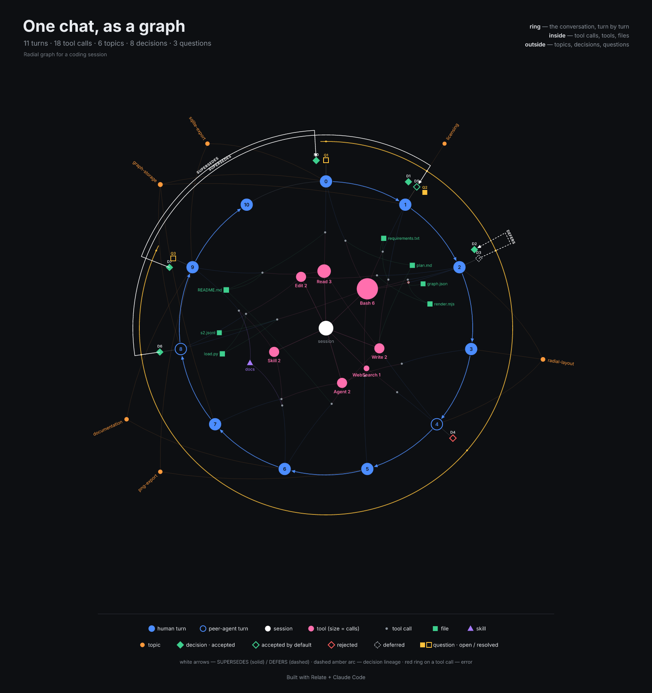

# session_graph — one Claude Code session as a knowledge graph

Turns one Claude Code session transcript into a knowledge graph stored in
[Relate](https://github.com/relatedb/relate) (the embedded Cypher graph database
at relatedb.ai), then draws the graph as a static radial SVG and PNG.



*The test fixture `tests/fixtures/synthetic/`, rendered. Its layer-2 tags are
hand-written test data, not model output.*

## Quick start

```bash
pip install -r requirements.txt                # relate-db==1.3.0, anthropic, pytest
(cd render && npm ci)                          # d3 7.9.0, @resvg/resvg-js 2.6.2
./build.sh ~/.claude/projects/<slug>/<uuid>.jsonl          # full pipeline
./build.sh <session.jsonl> --no-tag                        # layer 1 only; nothing leaves the machine
./build.sh <session.jsonl> --tagged my-tags.json           # load existing tags instead of calling Claude
open out/<uuid>/graph.png
```

Tagging needs Claude API credentials: `ANTHROPIC_API_KEY`, or a profile from
`ant auth login`. Without them the build prints a warning and finishes with
layer 1 only. Pass `--require-tag` to make that a failure.

## Pipeline

Each step is its own script and can be re-run on its own.

| step | script | in → out |
|---|---|---|
| 1 extract | `extract.py` | `<uuid>.jsonl` + `<uuid>/subagents/*.jsonl` → `out/<uuid>/extract.json` |
| 2 schema | `run_cypher.py --db … schema.cypher` | constraints and indexes (`IF NOT EXISTS`) |
| 3 layer 1 | `run_cypher.py --db … load.cypher --params extract.json` | episodic graph, all `MERGE` |
| 4 tag | `tag.py extract.json` | `out/<uuid>/tagged.json` (Claude, strict JSON schema) |
| 5 layer 2 | `run_cypher.py --db … layer2.cypher --params tagged.json` | semantic graph, `MERGE` on ids |
| 6 render | `query.py` → `render/render.mjs` | Cypher reads from Relate → D3 → `graph.svg`, then resvg → `graph.png` |

Steps 2–5 run against two stores: `out/<uuid>/graph.rl` (this session only, one
file) and `out/global/` (every session you have built, a directory).

### Extract: counting rules

The parser never crashes on what it does not recognise. Unknown entry types,
unknown content blocks, malformed lines and non-object lines are logged to
stderr once each and skipped.

- **Human turn**: a main-thread `user` entry with typed text. It is not
  `isMeta`, not a `tool_result`, and not a peer delivery. A `queued_command`
  attachment with plain text also counts, because that is the user typing
  while Claude was busy. `<system-reminder>` blocks are stripped. Input whose
  `origin.kind` is anything other than `human`, such as a PR alert or a
  scheduled check-in, is not a turn unless it is a subagent delivery.
- **Peer-agent turn**: a subagent result coming back. This is an
  `<agent-message from=…>` hand-back, a `<task-notification>`, or an
  Agent/Task `tool_result` carrying an `agentId`. There is one turn per agent
  id. The delivery that carries the report wins, and the tool_result stub is
  used only when nothing else arrived.
- **Turn text**: the incoming text. **Turn reply**: Claude's text output until
  the next turn. Both are stored, each capped at 4,000 characters.
- **Tool call**: a distinct `tool_use` block id, from the main thread or a
  subagent file. A call's `turn_index` is the latest turn at or before its
  timestamp. A subagent's calls belong to the peer turn that returned its
  result. `ok` comes from the matching `tool_result.is_error`. It is `null`
  when no result was logged.
- **File**: the `file_path` or `notebook_path` input of
  Read/Write/Edit/MultiEdit/NotebookEdit, the `path` input of Glob/Grep/LS, or
  a path-shaped token in a Bash command. A leading `cd /abs &&` resolves
  relative tokens. `File.detected_by` is `input` or `bash`.
- **Skill**: the `skill` input of a `Skill` tool call.

## Data model

```
layer 1 — episodic, deterministic (layer = 1)
(:Session {id, title, cwd, git_branch, cc_version, started, ended})
  -[:HAS_TURN]->(:Turn {id, session_id, index, role: human|peer_agent, timestamp, text, reply, delivery, agent_id})
(:Turn)-[:NEXT]->(:Turn)
(:Turn)-[:MADE]->(:ToolCall {id, session_id, turn_index, tool_name, input_summary, ok, error, agent_id, timestamp})
(:ToolCall)-[:USED]->(:Tool {name, call_count})
(:ToolCall)-[:TOUCHED]->(:File {path, detected_by, touch_count})
(:ToolCall)-[:INVOKED]->(:Skill {name})

layer 2 — semantic, model-generated (layer = 2, source = "model", confidence 0..1 on every node and edge)
(:Turn)-[:DISCUSSES]->(:Topic {slug})
(:Decision {key, id: D0..Dn, session_id, text, status: accepted|accepted_by_default|rejected|deferred, model})
  -[:DECIDED_IN]->(:Turn)
(:Decision)-[:SUPERSEDES]->(:Decision)
(:Decision)-[:DEFERS]->(:Decision)
(:Decision)-[:ABOUT]->(:Topic)                      # extra: lets you ask "every decision about X"
(:Question {key, id: Q1..Qn, session_id, text, status: open|resolved})
  -[:RAISED_IN]->(:Turn), -[:RESOLVED_IN]->(:Turn)
```

- Layer 1 never carries `source`. Layer 2 always does. A test enforces both.
- `Decision.key` and `Question.key` are `<session_id>:<id>`, so ids stay unique
  in the global store. `Topic.slug` and `File.path` are global. They merge
  across sessions.
- Re-running `layer2.cypher` for a session first removes that session's earlier
  layer-2 output, then merges the new output. Topics no longer mentioned by
  any turn are dropped.

### Tagging (layer 2)

`tag.py` sends turns in batches (default 12) to `claude-opus-5-5` at effort
`medium`. It uses structured outputs (`output_config.format`, a strict JSON
schema) and the server-side refusal fallback (`fallbacks: "default"`; turn it
off with `--no-fallback`). Each batch sees the decisions and open questions
found so far, so it can link SUPERSEDES/DEFERS and resolve earlier questions
across batches. The script assigns ids: `D0…Dn` and `Q1…Qn`, in turn order.
Turn indexes outside the batch are dropped, and so is a resolution that comes
before its question.

**What leaves the machine:** only turn text and reply text. Tool inputs, tool
results and file contents are never sent. Every string first goes through
`redact.py`, which removes:

- API keys: Anthropic, OpenAI, GitHub, AWS, Slack, Google
- JWTs and bearer tokens
- private keys
- `*PASSWORD=` / `*TOKEN=` style assignments
- credentials embedded in URLs
- email addresses

`tag.py --dry-run` writes the exact redacted payload to
`tagged.json.payload.json` and sends nothing.

## Cypher examples

Open a store from Python:

```python
import relate
db = relate.connect("out/global", read_only=True)
```

Or use the CLI: `relate -d out/global "<query>"`.

**Open questions**

```cypher
MATCH (q:Question {status: 'open'})-[:RAISED_IN]->(t:Turn)
RETURN q.session_id AS session, q.id AS id, q.text AS question, t.index AS raised_in, q.confidence
ORDER BY session, raised_in;
```

**Decision lineage** (each decision and what it superseded, transitively)

```cypher
MATCH p = (d:Decision)-[:SUPERSEDES*1..]->(old:Decision)
WHERE NOT ()-[:SUPERSEDES]->(d)
RETURN d.session_id AS session, [x IN nodes(p) | x.id + ' ' + x.status + ': ' + x.text] AS chain;
```

**Most-touched files**

```cypher
MATCH (f:File)<-[:TOUCHED]-(c:ToolCall)
RETURN f.path, count(c) AS touches, collect(DISTINCT c.tool_name) AS via
ORDER BY touches DESC LIMIT 20;
```

**Every decision about X across all sessions, with its supersession chain** (global store)

```cypher
MATCH (t:Topic) WHERE t.slug CONTAINS $x
MATCH (d:Decision)-[:ABOUT]->(t)
MATCH (d)-[:DECIDED_IN]->(turn:Turn)<-[:HAS_TURN]-(s:Session)
OPTIONAL MATCH chain = (d)-[:SUPERSEDES*1..]->(:Decision)
RETURN s.id AS session, s.started AS started, d.id AS id, d.status AS status, d.text AS text,
       [n IN coalesce(nodes(chain), []) | n.id] AS supersedes_chain
ORDER BY started, turn.index;
```

**Failed tool calls, with the turn that made them**

```cypher
MATCH (t:Turn)-[:MADE]->(c:ToolCall {ok: false})
RETURN t.session_id, t.index, c.tool_name, c.input_summary, c.error;
```

## Multi-session and MCP

- Every `build.sh` run writes its own `out/<uuid>/graph.rl` and also merges
  into `out/global/`.
- `Topic` merges on `slug`, `File` on `path`, and `Tool`/`Skill` on `name`.
  Sessions, turns and tool calls keep their own ids.
- The global store is a directory, not a `.rl` file. A Relate serve opened
  `--read-only=live` takes no writer lease, so you can keep building sessions
  into the store while agents query it.

Expose the global graph to agents over MCP. This needs the `relate` CLI, pinned
to v1.3.0. Install options are in the Relate README: `curl -sSfL
https://relatedb.ai/install.sh | bash`, `brew install relatedb/tap/relate`, or
the release binary checked against its `SHA256SUMS`.

```bash
relate serve --database out/global --mcp stdio --read-only=live
```

Example `.mcp.json` for Claude Code:

```json
{
  "mcpServers": {
    "session-graph": {
      "command": "relate",
      "args": ["serve", "--database", "/abs/path/to/out/global", "--mcp", "stdio", "--read-only=live"]
    }
  }
}
```

The server exposes `get_neo4j_schema`, `read_cypher` and `write_cypher`, the
same set as `mcp-neo4j-cypher`. Under `--read-only` it does not list
`write_cypher`.

## Tests

```bash
pytest tests/                                                    # synthetic drift fixture
SESSION_JSONL=~/.claude/projects/<slug>/<uuid>.jsonl pytest tests/ -s   # plus one real session
```

- `tests/raw_counts.py` re-derives the counts straight from the raw JSONL. It
  is written separately from `extract.py`.
- The test asserts that graph counts in Relate equal these raw counts exactly:
  - human turns and peer turns
  - tool calls, in total and per tool
  - distinct skills
  - failed calls
  - NEXT edges
- Every structured-input file path must also appear as a `File`.
- Other tests check:
  - loading twice is idempotent
  - layer 1 and layer 2 stay separate
  - tag id assignment
  - redaction
  - `--dry-run` sends nothing
  - render output

The synthetic fixture (`tests/make_fixture.py`) has the drift cases:

- an unknown entry type
- an unknown content block
- a malformed line and a non-object line
- a queued human prompt
- an `<agent-message>` peer result and a `<task-notification>` peer result
- subagent files
- `Skill` calls and failed calls

## Pinned versions

| component | version | how |
|---|---|---|
| Relate engine | **1.3.0** (2026-11-25) | `relate-db==1.3.0` (PyPI wheel, `import relate`), checked at the start of `build.sh` |
| Relate CLI (MCP serve) | **v1.3.0** | not used by the pipeline. Only for `relate serve` |
| d3 | 7.9.0 | `render/package.json` + lockfile |
| @resvg/resvg-js | 2.6.2 | `render/package.json` + lockfile |
| Claude model | `claude-opus-5-5` | `tag.py` |

The Cypher was checked against the Relate source docs at v1.3.0:
`docs/reference/cypher-syntax.md` (constraints, indexes), `docs/api/cli/spec.md`
(`serve`) and `docs/api/mcp/spec.md`. Every statement in `schema.cypher`,
`load.cypher` and `layer2.cypher` runs against the 1.3.0 engine in the tests.

## Known limits

- **Bash file detection is heuristic.** Paths built from shell variables
  (`$DIR/x`) are missed. Directories and paths that were only listed count as
  files. Relative paths resolve only after a leading `cd /abs`.
- **Turn attribution is by time.** A tool call belongs to the latest turn at or
  before it. Work Claude does after a subagent reports back is attributed to
  that peer turn.
- **Peer turns are one per agent id.** A subagent that reports more than once
  keeps its first report. Later reports are logged and dropped.
- **Layer 2 is model output.** It can be wrong, and every item carries a
  `confidence`. Topic slugs that differ only in wording do not merge across
  sessions. Normalisation is lowercase kebab-case only.
- **Large sessions:** turns above about 6,000 characters are truncated in the
  tagging payload. The renderer labels at most 28 files ("+N more files") and
  thins turn numbers when the ring gets crowded.
- **Transcript format drift:** the parser is tolerant, but new ways of
  delivering subagent results need a rule in `extract.py` and
  `tests/raw_counts.py`. Until then they are logged as unknown and not
  counted.
- **Not verified here:** the `relate serve` MCP command, because the CLI binary
  was not run in the environment this was built in. The tagging call was not
  run against the live API either, because no credentials were available.
  Its request shape matches the `anthropic` 2.14 SDK signature.
