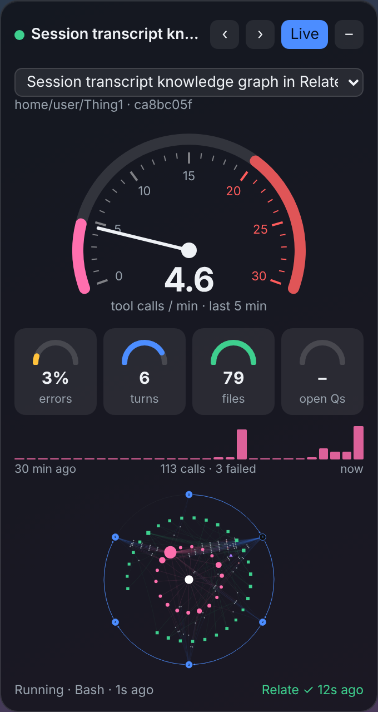
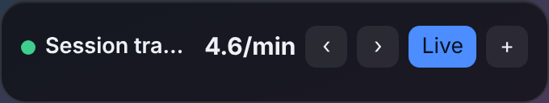

# session_meter: Claude Code engine meter for the Mac

A small window pinned to a corner of your screen, above other windows. It shows the
Claude Code chat you're in as an engine meter, plus its ring graph.

 

What it shows:

- **Tachometer**: tool calls per minute, averaged over the last 5 minutes. The red zone starts at 20.
- **Dials**:
  - errors: share of tool calls that failed
  - turns: the arc shows the share you typed
  - files: files touched
  - open Qs: open questions, filled in once the chat has been tagged
- **Sparkline**: tool calls per minute over the last 30 minutes.
- **Ring graph**: the same drawing as `session_graph`, compact. Turns are on the ring, tools and files inside it.
- **Footer**:
  - **Running · Bash · 3s ago**: the chat is active, and Bash was the last tool used.
  - **Idle**: nothing has happened in the chat for 90 seconds.
  - **Relate**: when this chat's graph was last saved to Relate.

How it works: every 2 seconds the app checks whether the current chat's transcript has
changed (`~/.claude/projects/<project>/<uuid>.jsonl` and its subagent files). When it
has, the app re-runs `session_graph/extract.py` and redraws the meter. About 20 seconds
after the last change, it loads the result into Relate, into both this chat's store
`~/.session_graph/<uuid>/graph.rl` and the global store `~/.session_graph/global/`.
Everything stays on your Mac. Nothing is sent anywhere.

## Setup (once)

You need Node 20+ and Python 3.9+. The python3 that comes with macOS (3.9) is enough.

```bash
git clone https://github.com/lerochernoir/Thing1 && cd Thing1
pip3 install -r session_graph/requirements.txt     # relate-db 1.3.0
(cd session_graph/render && npm ci)                # d3 for the drawing
cd session_meter && npm ci                         # Electron 45.3.1
npm start
```

A ◉ appears in the menu bar, and the meter appears in the top-right corner. This way
the Terminal has to stay open.

## Install as a Mac app (no Terminal)

```bash
cd Thing1/session_meter
npm run package
open ~/Applications/"Session Meter.app"
```

`npm run package` builds **Session Meter.app** on your Mac and copies it to
`~/Applications`. After that, open it like any app: from Spotlight (⌘Space, "Session
Meter"), Launchpad or Finder. It has no Dock icon and lives in the menu bar (◉). To start
it with your Mac, right-click ◉ → Open at login.

Notes:

- The app carries its own copy of the pipeline scripts. Re-run `npm run package` after a
  `git pull` to pick up changes.
- It still uses the Mac's `python3` with `relate-db` installed (the setup step above).
- Quit it from the menu (right-click ◉ → Quit). If it is already running when you
  rebuild, quit it first.

## Using it

| | |
|---|---|
| Show / hide | click ◉ in the menu bar, or press ⌘⇧G |
| Switch chats | ‹ older · › newer, or pick from the dropdown |
| Follow the active chat | **Live** (on by default). Picking a chat by hand turns it off. |
| Collapse to a bar | – (expand again with +) |
| Move it | right-click ◉ → Anchor top-right / top-left / bottom-right / bottom-left |
| Start with your Mac | right-click ◉ → Open at login |
| Reveal the transcript | double-click the chat title |

Settings are saved in `~/.session_graph/meter.json`. Environment overrides:

- `SESSION_METER_PYTHON`: which Python to run. Use this when `python3` on your PATH isn't the one with `relate-db` installed.
- `CLAUDE_PROJECTS_DIR`: where to look for chats.
- `SESSION_METER_HOME`: where to keep data.

## Topics, decisions and open questions

The meter shows layer 2 (topics, decisions, open questions) once the chat has been
tagged. To tag a chat with Claude, you need Python 3.10+ (`brew install python`). Run
`pip3 install -r session_graph/requirements-tag.txt`, set `ANTHROPIC_API_KEY`, then run:

```bash
python3 session_graph/tag.py ~/.session_graph/<uuid>/extract.json
```

This sends the chat's text to Claude, with secrets redacted first. The meter picks up
`tagged.json` on its next refresh.

## Tests

```bash
npm test                 # core: session listing, extraction, meters, compact graph, Relate sync
node test/preview.mjs    # renders the window's UI in headless Chromium with your newest chat
```

## Limits

- Only built and tested on Linux so far: the core logic, the Relate sync, and the UI
  rendered in Chromium. The Electron window itself has not run on a Mac yet. Expect
  small fixes to the window: vibrancy, menu-bar title, always-on-top over full-screen apps.
- If you run `session_graph/build.sh` while the meter is syncing, the two can briefly
  conflict over Relate's single-writer lock on the global store. The meter shows
  "Relate error" and retries on the next change.
- The meter doesn't read token usage yet, so there's no context "fuel" gauge.
